<!-- Cards in cards/ are generated: edit profile.json or render_cards.py, not the SVGs. -->

<a href="https://github.com/5aranx"></a>

<table>
<tr>
<td width="33%" valign="top"><a href="https://github.com/5aranx?tab=repositories"></a></td>
<td width="33%" valign="top"><a href="https://www.linkedin.com/in/mastermorphix"></a></td>
<td width="33%" valign="top"><a href="https://x.com/saransh_singh05"></a></td>
</tr>
</table>



<table>
<tr>
<td width="50%" valign="top"><a href="https://github.com/5aranx/Mayavi"></a></td>
<td width="50%" valign="top"><a href="https://github.com/5aranx/PUF-Based-Drone-Authentication-System"></a></td>
</tr>
<tr>
<td width="50%" valign="top"></td>
<td width="50%" valign="top"></td>
</tr>
<tr>
<td width="50%" valign="top"></td>
<td width="50%" valign="top"><a href="https://github.com/5aranx?tab=repositories"></a></td>
</tr>
</table>






