<!-- Cards in cards/ are generated: edit profile.json or render_cards.py, not the SVGs. -->

## About

I'm a final-year ECE student at DCRUST Murthal. I started on the blue-team side and now work mostly on offence: mobile app testing, hardware security and drone authentication. I organised HackRust 1.0, the national-level hackathon at DCRUST, and I'm an NCC Senior Under Officer.

## Selected work

## Technical focus

| Area | Tools and topics |
| --- | --- |
| Offensive security | Metasploit, Kali Linux, Android pentesting, PortSwigger labs (SQLi, XSS, SSRF, LLM prompt injection) |
| Mobile | ADB, Frida, SSL-pinning and root-detection handling, RASP-protected apps |
| Hardware | ESP32 and ESP32-S3, ESP-IDF, BLE, SRAM PUFs, BCH error correction |
| Languages | Python, C |
| Backend and tooling | Flask, Docker, QEMU/KVM, Linux |
| Blue team | Log analysis, kill-chain mapping, IoC extraction |
| Working toward | ISC2 CC |

Each line maps to something I've built, tested or been examined on.

## How I work

- **Authorised scope only.** Drax is built for assessments on apps I own or have been engaged to test.
- **Ask what the attacker gets.** For the PUF drone design the question was what a firmware dump reveals. The answer is public helper data and nothing else.
- **Say what's private.** Drax isn't public, so its card says so instead of linking nowhere.
- **Write it up.** Lab reports and READMEs get the same care as the code.

## Activity

